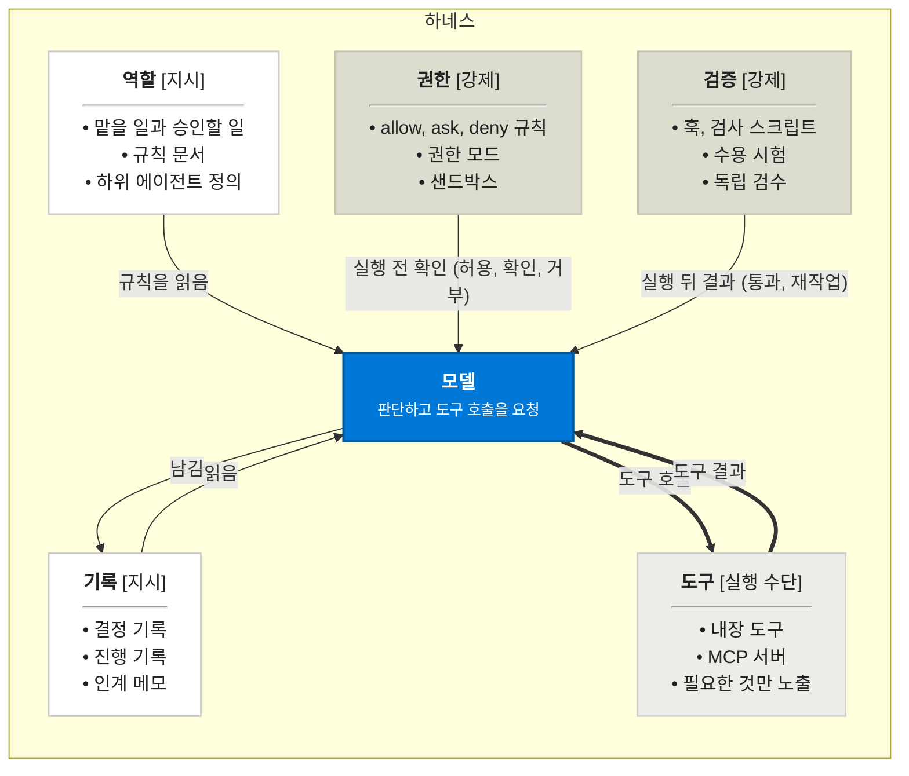

> **보관 문서(2026-10-28, D-147).** 더 이상 기준이 아닙니다. 원고 기준은 book-kit/book/PLAYBOOK.md와 BOOK_SPEC.md, 하위 에이전트 정의는 .claude/agents/(book-kit에서 동기화)를 따릅니다. 옛 결정의 근거를 찾을 때만 읽습니다.

# IT 도서 다이어그램 & 일러스트 표준 제작 가이드 (diagram_guide.md)

- **문서 버전**: v2.0 (통합 표준 개정본)
- **최종 개정일**: 2026-10-19
- **적용 대상**: 본서에 수록되는 모든 아키텍처 다이어그램, 데이터 흐름도, 시스템 개념도, 장 요약 도해
- **사용 범위**: 다이어그램을 그릴 때만 참고합니다(작가 결정, 2026-10-19).
- **문서 우선순위**: 본 가이드는 본서의 출판 디자인 원칙인 `FIGURE_STYLE.md`를 구체화한 실무 표준입니다. 하단 부록에 수록된 외부 AI 생성 원문의 내용 중 본서의 원칙(D-017, D-092, D-095, D-096)과 상충하는 항목(3D, 아이콘, 그라데이션, 영문 위주 라벨)은 본 도서에 적용하지 않습니다.

> 보관 메모: 받은 원문에는 목차의 6절(출판 전 품질 검수 체크리스트)과 7절(부록) 본문이 없었습니다. 원문을 받으면 아래에 채웁니다.

---

## 목차
1. [핵심 설계 철학 및 출판 규칙](#1-핵심-설계-철학-및-출판-규칙)
2. [다이어그램 시각 구조 4대 공식](#2-다이어그램-시각-구조-4대-공식)
3. [디자인 시스템 및 토큰 명세](#3-디자인-시스템-및-토큰-명세)
4. [표준 제작 파이프라인 (SOP)](#4-표준-제작-파이프라인-sop)
5. [표준 레퍼런스 구현 (Code & Template)](#5-표준-레퍼런스-구현-code--template)
6. [출판 전 품질 검수 체크리스트](#6-출판-전-품질-검수-체크리스트)
7. [부록: 외부 AI 생성 가이드 원문 (아이디어 참고용)](#부록-외부-ai-생성-가이드-원문-아이디어-참고용)

---

## 1. 핵심 설계 철학 및 출판 규칙

본서의 다이어그램은 화려한 시각 효과보다 **"구조의 명확성, 직관적인 정보 위계, 인쇄 가독성"**을 최우선으로 합니다.

| 규칙 ID | 원칙 명칭 | 세부 지침 |
| :--- | :--- | :--- |
| **D-017** | **비유 삽화 및 벤더 아이콘 배제** | 장식용 클립아트, 은유적 일러스트, 클라우드 벤더(AWS, Azure, GCP, Cisco 등)의 공식 아이콘을 배제합니다. 오직 **정형화된 박스(Box)와 커넥터(Line/Arrow)**만으로 관계를 설명합니다. |
| **D-092** | **완전한 2D 플랫(Flat) 준수** | 3D 입체 효과, 아이소메트릭(Isometric), 원근감, 드롭 섀도(그림자), 그라데이션을 일체 금지합니다. 인쇄 시 잉크 번짐과 가독성 저하를 방지하기 위해 순수 평면 벡터 도면 스타일을 유지합니다. |
| **D-095** | **국문 우선 라벨링** | 고유 프로토콜명이나 코드 예약어(MCP, allow, ask, deny 등)를 제외한 모든 노드 타이틀과 상호작용 동작 설명은 자연스럽고 명확한 한국어로 작성합니다. |
| **D-096** | **단일 강조색 및 무채색 계층화** | 배경은 완전한 흰색(#FFFFFF)을 사용하며, 구성 요소의 분류는 **3단계 무채색 명도(Grayscale)**로 구분합니다. 독자의 시선을 유도하는 포인트 컬러는 **단 1개의 Primary Blue(#0078D7)**만 허용합니다. |

---

## 2. 다이어그램 시각 구조 4대 공식

모든 장의 핵심 개념 다이어그램은 독자가 페이지를 펼쳤을 때 3초 안에 핵심을 파악할 수 있도록 아래 4대 구성 요소를 필수적으로 갖추어야 합니다.

```text
┌────────────────────────────────────────────────────────────────────────┐
│ [공식 1] 주장형 헤드라인 (Takeaway Headline) + 객관적 부제             │
├────────────────────────────────────────────────────────────────────────┤
│ ┌─ [공식 2] 시스템 경계 (점선 바운더리 박스: 하네스 등) ─────────────┐ │
│ │                                                                    │ │
│ │ [공식 3] 역할 노드 (지시: 흰색) ────────┐                          │ │
│ │                                         ▼                          │ │
│ │ 기록 노드 (지시) ──▶ [공식 3] 모델 (단일 강조: Blue) ──▶ 도구 노드 │ │
│ │                                         ▲          (실행: 연회색)  │ │
│ │ 권한 노드 (강제: 중회색) ───────────────┘                          │ │
│ │                                                                    │ │
│ │ 범례(Legend): □ 지시  □ 실행 수단  ■ 강제  ■ 강조(주 흐름)        │ │
│ └────────────────────────────────────────────────────────────────────┘ │
├────────────────────────────────────────────────────────────────────────┤
│ [공식 4] '그래서 할 일' 박스 (독자 실천 지침 요약)                     │
└────────────────────────────────────────────────────────────────────────┘
```

### (1) 공식 1: 주장형 헤드라인 (Takeaway Headline)
- **개념**: 단순 명사형 제목(예: `하네스 구성도`)을 지양하고, 다이어그램이 독자에게 증명하고자 하는 **핵심 결론/주장**을 문장 형태로 제시합니다.
- **구조**:
  - **헤드라인 (2줄 이내)**: 본문의 핵심 논리를 담은 문장 (20px, Bold, #222222)
  - **구분선**: 헤드라인과 본도를 가르는 파란색 악센트 라인 (3px, #0078D7)
  - **부제**: 다이어그램이 다루는 객관적인 범위 설명 (14px, Regular, #666666)
- **예시**:
  - *헤드라인*: "다섯 구성 요소를 모두 정해야 / 에이전트의 결과를 받아들일 근거가 생깁니다"
  - *부제*: "하네스의 다섯 구성 요소와, 모델과의 사이에 오가는 것"

### (2) 공식 2: 외곽 바운더리 점선 박스 (Boundary Box)
- **개념**: 시스템의 실행 환경, 격리 영역, 런타임 프레임워크(하네스, 서브넷 등)를 논리적으로 감싸는 테두리입니다.
- **사양**:
  - 테두리: 회색 점선 (`Stroke: #666666`, 두께 `1.5px`, `Dash: 6, 6`)
  - 모서리 곡률: `Corner Radius: 8px`
  - 배경: 순백색 배경과 미세하게 구분되는 초미색 (`#FBFBFB`)
  - 영역 라벨: 좌측 상단 내부에 영역 명칭(16px, Bold, #333333) 표기

### (3) 공식 3: 무채색 명도 계층(Layer) + 단일 강조색
- **명도 기반 층 구분**: 요소의 성격(권한, 역할, 도구 등)을 색상이 아닌 **명도(Grayscale)**의 밝기 차이로만 통제하여 시각적 피로도를 없앱니다.
  - **지시 (Directive)**: 흰색(#FFFFFF) 또는 밝은 회색(#F8F8F8) / 얇은 보더
  - **실행 수단 (Execution)**: 밝은 미색 회색(#ECECE8 / K 10~15%)
  - **강제 (Enforcement)**: 중간 회색(#DDDDCF / K 30~35%)
- **단일 강조색 (Primary Blue, #0078D7)**:
  - 시스템의 판단 주체(예: `모델`) 노드 배경 전체에 적용
  - 시스템에서 가장 중요한 인터랙션(예: `도구 호출`, `도구 결과`) 화살표 및 텍스트에 적용
- **하단 범례 명시**:
  - 바운더리 박스 내부 우측 또는 좌측 하단에 각 층의 사각 칩과 설명을 한 줄로 배치

### (4) 공식 4: '그래서 할 일' 실천 지침 블록
- **개념**: 다이어그램을 다 본 독자가 업무 현장에서 취해야 할 액션 플랜을 1문장으로 요약합니다.
- **사양**:
  - 외곽 박스: `Fill: #F8F9FA`, `Stroke: #E5E7EB`, `Radius: 8px`, `Padding: 16px`
  - 소제목: `그래서 할 일` (13px, Bold, #0078D7)
  - 본문: 구체적인 실천 지침 문장 (13px, Medium, #222222)
- **예시**: `반드시 지킬 규칙은 권한과 검증으로 두고, 나머지는 규칙 문서로 안내합니다.`

---

## 3. 디자인 시스템 및 토큰 명세

모든 다이어그램은 피그마(Figma) 또는 벡터 제작 툴에서 아래 토큰 규격을 엄격히 준수합니다.

### 3.1. 컬러 팔레트 (Color Tokens)

| 토큰명 | 용도 | HEX | CMYK 인쇄 기준 |
| :--- | :--- | :--- | :--- |
| `Canvas-BG` | 전체 도화지 배경 | `#FFFFFF` | C:0 M:0 Y:0 K:0 |
| `Boundary-BG` | 하네스/시스템 외곽 내부 | `#FBFBFB` | K:2% |
| `Boundary-Line` | 점선 테두리 | `#666666` | K:70% (Dash 6, 6) |
| `Layer-Directive` | 1층: 지시 (역할, 기록) | `#FFFFFF` (보더 `#CCCCCC`) | K:0% / 보더 K:20% |
| `Layer-Execution` | 2층: 실행 수단 (도구) | `#ECECE8` (보더 `#D0D0CA`) | K:12% |
| `Layer-Enforce` | 3층: 강제 (권한, 검증) | `#DDDDCF` (보더 `#C5C5B5`) | K:32% (확실한 대비 확보) |
| `Primary-Blue` | 모델 노드, 핵심 화살표 | `#0078D7` | C:85 M:50 Y:0 K:0 |
| `Text-Title` | 헤드라인, 카드 제목 | `#222222` | K:95% |
| `Text-Body` | 노드 내부 본문, 화살표 라벨 | `#333333` | K:85% |
| `Text-Muted` | 부제, 범례 텍스트 | `#666666` | K:65% |

### 3.2. 타이포그래피 (Typography Tokens)

- **권장 서체**: `Pretendard`, `Noto Sans KR` (산세리프 고딕 계열 단일화)

| 구분 | 크기(Font Size) | 두께(Weight) | 행간(Line Height) | 글자색 |
| :--- | :--- | :--- | :--- | :--- |
| **메인 헤드라인** | `20px` | Bold (700) | 130% | `#222222` |
| **부제** | `14px` | Regular (400) | 140% | `#666666` |
| **바운더리 명칭** | `16px` | Bold (700) | 100% | `#333333` |
| **카드 타이틀** | `16px` | Bold (700) | 100% | `#222222` |
| **카드 뱃지** | `12px` | Regular (400) | 100% | `#555555` |
| **카드 본문 불릿** | `13px` | Regular (400) | 150% | `#333333` |
| **화살표 라벨** | `12px` | Regular (400) | 130% | `#333333` / `#0078D7` |
| **핵심 모델 노드** | 타이틀 `19px`(Bold), 설명 `13px`(Regular) | | 130% | `#FFFFFF` |

### 3.3. 컴포넌트 규격 및 오토레이아웃 (Layout Metrics)

- **전체 다이어그램 프레임**: 기준 가로폭 `800px` (세로는 내용에 따라 가변, 기본 `900~920px`)
- **노드 카드 모서리(Corner Radius)**: 일반 카드 `8px`, 중앙 모델 노드 `10px`, 하단 액션 박스 `8px`
- **뱃지(Badge)**: 모서리 `100px`(알약 형태), 내부 패딩 가로 `8px`, 세로 `3px`, 배경 흰색
- **화살표(Connector)**: 기본 선 두께 `1.5px` (`#666666`), 핵심 강조 화살표 `2.0px` (`#0078D7`)

---

## 4. 표준 제작 파이프라인 (SOP)

이미지 생성 AI(Midjourney 등)의 결과물을 책에 그대로 얹지 않고, 아래의 체계적인 4단계 워크플로우를 통해 제작합니다.

```text
[Step 1: 기획/메시지] ➔ [Step 2: 구조 검증] ➔ [Step 3: Figma 조립] ➔ [Step 4: 인쇄 감리]
 원고 핵심 주장 도출      Mermaid 텍스트 검증     공식 템플릿/식자       출판 스펙 QA
```

### Step 1: 기획 및 메시지 도출 (LLM / 기획자)
1. 본문 원고를 분석하여 해당 절에서 독자가 반드시 기억해야 할 1문장을 도출합니다 → **헤드라인 문장 확정**.
2. 다이어그램에 참여하는 주체(Actor/Component)를 나열하고, 그들의 성격을 `지시`, `실행 수단`, `강제` 중 하나로 분류합니다.

### Step 2: 텍스트 및 논리 구조화 (Mermaid 검증)
1. 컴포넌트 간 오가는 상호작용 화살표 라벨을 구체적인 동작 서술어(예: `규칙을 읽음`, `실행 전 확인`)로 정의합니다.
2. 마크다운 에디터에서 Mermaid 코드를 작성해 노드 간 꼬임이 없는지 1차 확인합니다.

### Step 3: Figma 템플릿 조립 및 식자 (Designer / Writer)
1. 규격 프레임(800px) 위에 외곽 점선 박스를 생성합니다.
2. 오토레이아웃(`Shift + A`) 기반 카드 컴포넌트에 텍스트를 입력하고 배치합니다.
3. 커넥터 도구(`Shift + C`)로 노드 간 선을 잇고, 더블 클릭하여 동작 라벨을 입력합니다.
4. 모델 노드와 주 흐름 화살표에만 `Primary-Blue`(#0078D7)를 부여합니다.
5. 하단 범례와 '그래서 할 일' 박스를 조립합니다.

### Step 4: 출판 인쇄 감리 및 벡터 추출
1. 흑백 모드 전환 테스트를 수행하여 `실행 수단(연회색)`과 `강제(중회색)`의 명도 대비가 유지되는지 확인합니다.
2. 글꼴 깨짐 방지를 위해 모든 텍스트의 윤곽선 만들기(Create Outlines, `Ctrl + Shift + O`)를 거친 후 SVG 또는 인쇄용 고해상도 PDF로 내보냅니다.

---

## 5. 표준 레퍼런스 구현 (Code & Template)

### 5.1. 마크다운 문서용 Mermaid 코드



---

## 6. 출판 전 품질 검수 체크리스트

(받은 원문에 본문이 없습니다. 원문을 받으면 채웁니다.)

---

## 부록: 외부 AI 생성 가이드 원문 (아이디어 참고용)

(받은 원문에 본문이 없습니다. 같은 성격의 원문은 저장소의 `AI_DIAGRAM_GUIDE.md`에 보관되어 있습니다.)
